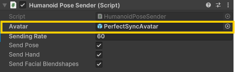

# Humanoid Pose Connector

This is a Unity package for sending and receiving VRM avatar bone Transforms and facial BlendShape weights via OSC.

## Installation

1.  **Import uOSC**
    Import [uOSC](https://github.com/hecomi/uOSC) into your Unity project.
    You can import it via Unity Package Manager (UPM) or by direct download from GitHub.

2.  **Import Humanoid Pose Connector**
    Open `Window` > `Package Manager` from the Unity menu bar.
    Click the `+` button in the upper left corner and select `Add package from Git URL...`.
    Enter the following URL and click `Add`.
    - URL: `https://github.com/ec-k/HumanoidPoseConnector.git?path=/Assets/HumanoidPoseConnector#v0.2.2`

## How to Use

### Sender

1. Place `Prefabs/HumanoidPoseSender` in the Hierarchy.
2. Drag & Drop the avatar object you want to synchronize onto the Avatar field of HumanoidPoseSender.

### Receiver

1. Place `Prefabs/HumanoidPoseReceiver` in the Hierarchy.
2. From the script that uses the received data, subscribe to the `HumanoidPoseReceiver.OnMessageReceived` event.
   - Properties such as `PoseResults`, `BlendshapeResults`, and `LastReceivedTime` are publicly exposed, so you can access them directly.
