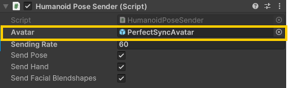

# Humanoid Pose Connector

VRM アバターのボーンの Transform と表情の BlendShape のウェイトを OSC で送受信するための Unity パッケージです．

## Installation

1.  **uOSC のインポート**
    [uOSC](https://github.com/hecomi/uOSC)を Unity プロジェクトにインポートします．
    Unity Package Manager (UPM) 経由，または GitHub から直接ダウンロードしてインポートしてください．

2.  **Humanoid Pose Connector のインポート**
    Unity のメニューバーから `Window` > `Package Manager` を開きます．
    左上の `+` ボタンをクリックし，`Add package from Git URL...` を選択します．
    以下の URL を入力し，`Add` をクリックします．
    - URL: `https://github.com/ec-k/HumanoidPoseConnector.git?path=/Assets/HumanoidPoseConnector#v0.2.2`

## 使い方

### 送信側

1. `Prefabs/HumanoidPoseSender`を Hierarchy に配置する
2. HumanoidPoseSender の Avatar に，同期するアバターのオブジェクトを Drag & Drop で設定します．

### 受信側

1. `Prefabs/HumanoidPoseReceiver`を Hierarchy に配置する
2. 受信したデータを利用するスクリプトから，`HumanoidPoseReceiver.OnMessageReceived`イベントを購読します．
   - `PoseResults`, `BlendshapeResults`, `LastReceivedTime`などのプロパティは public で公開されているため，直接アクセスすることも可能です．
